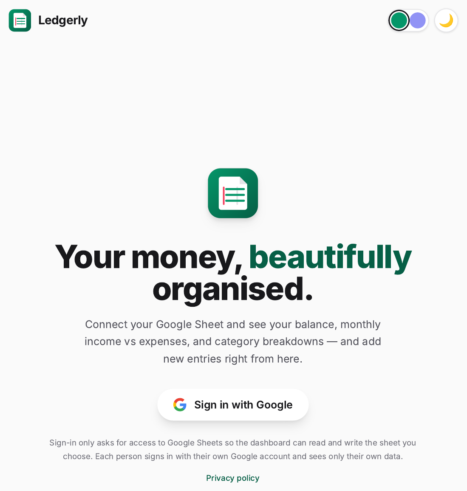

# Ledgerly

A simple, modern expense tracker backed by your own Google Sheet. Sign in
with Google, connect a sheet (or create one in the right format from inside
the app), and see your balance, monthly spending pace, category breakdowns and
reports — and add entries from the dashboard or your phone.

## Try it live

**https://cash-dashboard-two.vercel.app**

No install needed. Sign in with Google, connect your sheet, and your data is
there. On Android you can install it as an app from the browser menu.



## What it does

- **Overview** — balance at a glance, a spending-pace card (safe-to-spend per
  day, projected month-end, fixed vs one-off vs everyday split), monthly
  targets, unusual-spending insights, expected recurring payments, and a
  calendar heatmap of your days.
- **Transactions** — grouped by day, with search, filters, sorting,
  pagination, multi-select bulk delete, and edit in place.
- **Reports** — monthly or yearly view: daily trend, 12-month income vs
  spending, share-of-spending donut, category bars, and a year summary.
- **Manage** — your own category list (add, rename, reorder), accounts with
  transfers between them, recurring payments (mark, pause, edit), monthly
  budgets, CSV import and export, a 30-day trash, and notes.
- **Multi-sheet** — connect more than one sheet and switch between them from
  the header; create a brand-new sheet in the right format without leaving
  the app.
- **Private by design** — no database, no analytics, no tracking. Your data
  lives only in your own Google Sheet, accessed with your own Google account.
  Each signed-in visitor sees only their own sheet, and a sheet connection
  never leaks to another account on the same device.
- **Themes** — light/dark mode with emerald and indigo accents, saved in
  your browser.

## Sheet format

A Google Sheet with monthly tabs named `January`–`December`. Each tab's header
row is:

```
ID | Date | Type | Category | Description | Amount | Currency | Linked account | Link ID | Notes
```

- `Type` is `Debit` (expense) or `Credit` (income).
- `Date` is `YYYY-MM-DD`. New entries are appended to the tab for the month of
  their date, with a fresh UUID in `ID`.
- `Currency` is `BDT`.
- `Linked account` / `Link ID` are used by accounts and transfers; leave them
  blank and everything counts as your default account.
- Tabs may be empty except the header; missing tabs and extra non-month tabs
  are tolerated. The app may add `Categories`, `Accounts`, `Trash`, `Notes`,
  `Recurring` and `Budgets` tabs to the sheet to store its lists — your
  entries are never moved or reformatted.

Don't have a sheet yet? Choose "Create a new sheet" after signing in and the
app makes one for you in this format.

## How your data is handled

- Sign-in is Google OAuth with the `spreadsheets` scope only — the app can
  read and write the sheets you connect, nothing else in your Google account.
- Tokens live only in the encrypted server-side session; they are never sent
  to the browser.
- The app never copies your data anywhere: every screen reads straight from
  your sheet, and edits write straight back to it.
- Full details: [Privacy policy](https://cash-dashboard-two.vercel.app/privacy).

## Tech

Next.js (App Router), TypeScript, Tailwind CSS, NextAuth, and the Google
Sheets API — no database.
